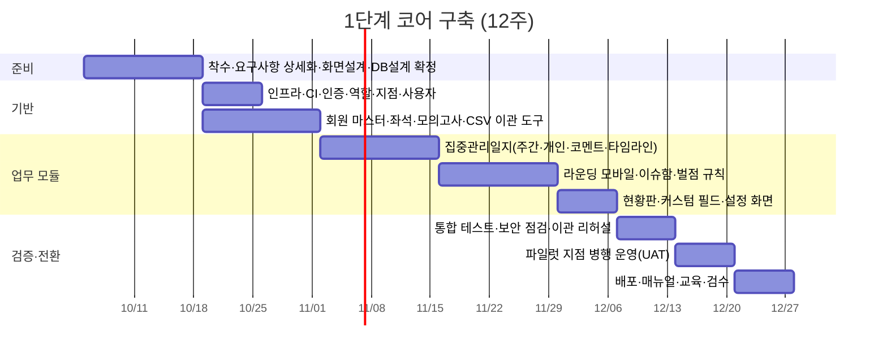

# 프로젝트12 통합관리 플랫폼 · 프로젝트 기획서

| 항목 | 내용 |
|---|---|
| 코드명 | 별하 (가칭, 폴더명 기준) |
| 버전 | v0.1 초안 (2026-09-05) |
| 입력 자료 | `견적요청서_업무범위_요건(RFP).md`, `프로젝트12_관리시스템 통합.pptx` (2026-07-18) |
| 함께 보기 | [02_시스템_설계서.md](02_시스템_설계서.md) |
| 관점 | 발주사(프로젝트12) 내부 기획 기준. 벤더 제안 평가 기준표로도, 자체 구축 시 실행 계획으로도 사용 가능 |

---

## 1. 현행 분석 (As-Is)

### 1.1 현행 도구 지도

PPTX 자료 기준으로 회원 관련 업무는 11개 도구에 흩어져 있고, 그중 6개가 구글 시트 + Apps Script다.

| # | 도구 | 용도 | 운영 방식 | 문제점 |
|---|---|---|---|---|
| 1 | 좌석관리 프로그램 (상용) | 좌석 등록·결제·미수금, 지문 출입 | 유지 (범위 제외) | 회원 기본정보 이중 입력 |
| 2 | 고객정보시트 | 회원 상세, 모의고사 신청 | 시트 1개, 탭 2개 | 사실상 마스터이지만 타 시트와 미연동 |
| 3 | 집중관리일지 | 주간 상담 + 집중관리 학생 개인 일지 | 지점별·월별 파일, 학생별 탭 | 월마다 생성, 이력 조회 불가, 소통은 잔디에서 |
| 4 | 라운딩 일지 | 하루 최대 12회 좌석 점검 | 인쇄물 수기 기록 | 회원 변동 시 재인쇄, 집계 불가, 이슈는 잔디 보고 |
| 5 | 게시용 생활관리 현황판 | 매장 모니터 게시 | 매주 월요일 템플릿 자동 복사 | 회원 변경 시 템플릿 수동 갱신 |
| 6 | 식사주문 시트 | 월별 중·석식 신청, 일별 발주 합산, 월 정산 | 매월 25일 자동 생성 | 템플릿 수동 갱신, "전일 마감" 강제 불가 |
| 7 | 조교 근무일지 | 타임별 근태, 초과근무, 급여 기초 (직영점) | 매일 자동 생성 | 월 집계 수작업, 비품 재고 기능은 사장됨 |
| 8 | HERO 학습진단 (자체 웹앱) | 설문 → 결과분석지 | 별도 운영 | 회원 프로필과 미연결 |
| 9 | AI 학습컨설팅 리포트 | 40p PDF | 별도 생성 | 회원 프로필과 미연결 |
| 10 | 카카오톡 | 회원·학부모 소통 | 지점별 채널 친구추가 | 수동 발송, 미사용자 제약 |
| 11 | 잔디 | 직원 업무 소통 | 지점별 팀 | 출퇴근·이슈·상담 소통이 채팅에 뒤섞임 |

### 1.2 핵심 문제 정의

1. **회원 명단이 6곳에 복제**되어 있어 등록·퇴원·좌석 변경 시 6곳을 손으로 고친다. 불일치가 생기면 어느 것이 맞는지 알 수 없다.
2. **현장 기록이 종이와 채팅에 흩어져** 있어 회원별 이력, 벌점 추이, 이슈 처리 현황을 집계할 수 없다.
3. **템플릿 복사 방식**이라 양식이 바뀌면 Apps Script를 고쳐야 하고, 담당자가 바뀌면 유지가 어렵다.

### 1.3 현행 데이터에서 파악한 구조 (설계 근거)

스크린샷에서 확인한 실제 컬럼이다. 설계서의 데이터 모델은 이를 그대로 수용한다.

| 시트 | 확인된 구조 |
|---|---|
| 고객정보 | 좌석번호(사실상 키), 성명, 연락처, 생년월일, 나이, 성별, 구분(학생/성인), TYPE(N수생/재학생/검정고시), 집중관리(O/X), 목표대학·학과·시험, 학교명/학년, 계열(문과/이과/예체능), 주소. 단기 회원은 이름 뒤 "/S"와 "7월16~8월17일[33일]" 식 기간 표기 |
| 모의고사 탭 | 월 회차별로 좌석번호, 성명, 신청여부, 계열, 학교, 결제일, 과목 조합(비고), 계열별 취합 인원. 회차 단가 29,000원 |
| 집중관리일지 | 주간 상담일지: 좌석번호, 이름, 학교/학년, 첫 등록일, 첫 상담일, 집중관리, "정보 및 이슈(원장님) N주차" ↔ "이슈 해결내용(선생님) N주차" 2열 반복. 개인 탭: 날짜별 같은 2열 |
| 라운딩 일지 | 좌석 순 행(좌석번호, 이름, 특이사항), 열: 등원시간, CALL, R1~R12, 비고. 구역별 행 색상 |
| 현황판 | 좌석 열 × 항목 행(출석, 플래너, R1~R11, 영단어, 점검완료), 일자 블록 반복. a=초록, b=연두, 벌점=빨강+점수. 상단에 주간 벌점 합계와 벌점 규칙(이동금지 5, 휴대폰 전원 미차단 2, 무단 미등원 8, 졸음 3, 연속 졸음 6, 지각 4) |
| 식사주문 | 날짜 × (L/D) 체크, 하단 일자별 합계. 토요일은 중식만, 일요일 주문 불가. 회원별 합계·식사비용(단가 8,000원 추정)·결제일·결제액 |
| 근무일지 | 근무자, 근무형태(주간조교/야간조교/컨설팅/원장), 근무요일, 1~7타임 + 일1/일2타임 체크, 근무시간, 초과근무, 사유, 본사확인, 총 근무시간 |

---

## 2. 프로젝트 목표와 성공 기준

| 목표 | 내용 | 성공 지표 |
|---|---|---|
| 단일 회원 마스터 | 회원 정보를 한 곳에서 수정하면 전 모듈에 즉시 반영 | 회원 변경 시 수정 지점 6곳 → 1곳 |
| 현장 입력 디지털화 | 라운딩을 스마트폰·태블릿으로 입력, 이슈가 지점장에게 실시간 도달 | 라운딩 집계 지연 익일 → 실시간 |
| 소통의 업무화 | 상담 코멘트·이슈함·출퇴근 체크로 잔디의 업무성 채팅 대체 | 잔디 업무 메시지 유형 3종(상담·이슈·출퇴근) 제거 |
| 운영 자동화 | 주간 현황판·월 식사·일 근무 시트의 템플릿 복사 제거 | 템플릿 수동 갱신 횟수 0 |
| 안전한 전환 | 파일럿 지점 병행 운영 후 시트 폐기 | 병행 2주 내 데이터 불일치 0건으로 컷오버 |

---

## 3. 범위

### 3.1 단계별 범위

**1단계 · 코어 구축 (우선 계약)**

| 모듈 | 포함 기능 |
|---|---|
| 1-1 회원 마스터 | 회원 CRUD, 상태(상담/등록/퇴원, 휴원은 옵션), 좌석 배정, 등록기간 이력, 학부모 정보, 집중관리 지정, 모의고사 회차·신청·결제 관리, CSV 이관 도구, 변경 이력 |
| 1-2 집중관리일지 | 주간 상담일지(전 회원 × 주차), 집중관리 회원 일별 상세일지, 원장·멘토 2열 작성 + 코멘트 스레드 + 멘션 알림, 회원별 타임라인, 주/월/멘토/집중관리 필터 |
| 1-3 라운딩 (모바일) | 지점별 회차 시간표, 회차 시작→좌석 순 점검→완료, 기본값 a에 예외만 탭, 벌점 규칙 선택 시 점수 자동, 특이사항·이슈 보고, 오프라인 임시 저장, 회차/일/회원별 조회, 지점장 이슈함 |
| 1-4 현황판 | 주 단위 좌석 × 항목 그리드, a/b/벌점 색상, 주간 벌점 합계, 규칙 헤더, 전체화면 키오스크 모드, 자동 새로고침, 실명/마스킹 표시 옵션 |
| 공통 | 로그인·역할·지점 격리, 본사 지점 전환, 설정(지점·사용자·좌석·벌점 규칙·현황판 항목·회차 시간표), 비개발자용 커스텀 필드, 감사 로그, 알림함 |
| 산출물 | 운영 배포, 이관 완료, 관리자 매뉴얼, 현장 교육 1회, 배포 구성 문서 |

**2단계 · 운영 확장**

| 모듈 | 포함 기능 |
|---|---|
| 2-1 식사주문·정산 | 월별 회원 × 날짜 × 중/석식 그리드, 전일 마감 규칙(시각 설정), 요일 규칙(토 중식만·일 불가), 일자별 발주 합계·출력, 회원별 월 집계·후불 결제액·결제 처리 |
| 2-2 근무일지·급여 | 지점별 타임 슬롯 정의, 출퇴근 체크(타임 단위), 초과근무·사유, 본사 확인, 월별 근무시간 집계, 지점별/월별 통계, 급여 기초자료 내보내기 |
| 2-3 카카오 알림톡 | 공식 딜러 API 연동, 템플릿 변수 매핑, 대상 선택(개인/그룹/지점/학부모), 발송 이력·실패 재발송 |

**3단계 · 외부 연동**

| 모듈 | 포함 기능 |
|---|---|
| 3-1 HERO 진단 연동 | 진단 결과를 회원 프로필에 연결 (API 또는 파일 업로드, 협의) |
| 3-2 AI 컨설팅 리포트 | 회원별 PDF 업로드·조회·버전 관리 |
| 3-3 사내 메신저 (별도 견적) | 오픈소스 메신저 셀프호스팅(GCP), 지점별 채널, 계정, 모바일 푸시 검증, 플랫폼 이벤트 → 채널 웹훅 알림, 전환 지원 |

### 3.2 범위 제외

좌석 결제·지문 출입 시스템, CCTV 관제, 콜센터. 단, 좌석관리 프로그램의 회원 데이터 export 가능 여부는 이중 입력 최소화를 위해 확인한다.

### 3.3 명시적 가정 (RFP에 없어 이번 기획에서 정한 것)

| # | 가정 | 근거 | 확인 필요 |
|---|---|---|---|
| A1 | 조교는 개인 계정을 갖되, 매장 공용 태블릿에서 PIN으로 빠르게 전환한다 | 알바 교체가 잦고 책임 추적이 필요 | 예 |
| A2 | 현황판은 지점별 비공개 URL(토큰)로 모니터에 띄우고, 실명/마스킹은 설정으로 고른다 | 미성년자 개인정보 노출 최소화 | 예 |
| A3 | 상담일지 주차는 월요일 시작 ISO 주차, 월 필터는 주차 시작일 기준 | 현황판이 월요일 갱신 | 예 |
| A4 | 벌점 규칙과 회차 시간표는 본사 기본값 + 지점 오버라이드 | 지점 확장 대비 | 예 |
| A5 | 라운딩 기본값은 a(양호)이며 조교는 예외만 입력한다 | 현황판 대부분이 초록 | 예 |
| A6 | 클라우드는 GCP 서울 리전(3-3에서 GCP 언급) | RFP 3-3 | 예 |
| A7 | 라운딩·현황판 과거 데이터는 이관하지 않고 최근 4주만 선택 이관 | 이관 비용 대비 효용 | 예 |

---

## 4. 이해관계자와 역할

| 역할 | 누구 | 주요 업무 | 주 사용 기기 |
|---|---|---|---|
| 본사 관리자 | 본사 운영팀 | 전 지점 조회·통계, 지점·사용자·양식·규칙 설정, 이관, 근태 본사확인 | PC |
| 지점장(원장) | 지점별 1명 | 회원 관리, 상담 "정보 및 이슈" 작성, 이슈 처리, 현황판·식사·근태 관리 | PC + 스마트폰 |
| 멘토(선생님) | 지점별 n명 | 상담 "이슈 해결내용" 작성, 코멘트, 집중관리 학생 일지 | PC + 스마트폰 |
| 조교(알바) | 지점별 n명, 교대 | 라운딩 입력, 출석·플래너·영단어·점검 체크, 이슈 보고, 출퇴근 체크 | 스마트폰·태블릿 |
| 회원·학부모 | 시스템 직접 사용 없음 | 현황판 열람(매장 모니터), 알림톡 수신 | 모니터·카카오톡 |

---

## 5. 개발 방식 검토 및 결정

### 5.1 후보 비교

핵심 화면(라운딩 모바일, 현황판, 상담 코멘트, 식사 그리드)은 어느 방식이든 커스텀 개발이 필요하다. 차이는 "인증·권한·관리자 CRUD·양식 편집"을 어디서 얻느냐다.

| 구분 | A안 · 풀커스텀 모노리스 | B안 · 오픈소스 데이터 플랫폼 + 커스텀 프론트 | C안 · Supabase 기반 |
|---|---|---|---|
| 구성 | Next.js + PostgreSQL 단일 앱 | Directus(백엔드·관리자·스키마 편집기) + Next.js(현장 화면) | Supabase(Auth·DB·RLS·Storage) + Next.js |
| 비개발자 양식 편집 | 커스텀 필드 기능을 직접 구현 (1주) | 기본 제공 (강점) | 직접 구현 |
| 다지점 격리 | 앱 스코핑 + Postgres RLS | Directus 권한 필터 (설정 복잡) | RLS 기본 |
| 라이선스 | 전부 MIT/Apache/PostgreSQL | Directus BSL 1.1 (연매출 500만 달러 미만 무료, 견적서에 명시 필요) | Apache 2.0 |
| 운영 부담 | 컨테이너 1 + DB 1 | 컨테이너 2 + DB 1, 관리자 UI 2개 | 셀프호스트 시 컨테이너 10개 이상, 관리형은 외부 SaaS |
| 장기 유지보수 | 코드가 곧 명세, AI 보조 개발에 유리 | 플랫폼 버전업 추종 필요 | 관리형이면 편하나 데이터 소유권 협의 |
| 적합도 | 높음 | 관리자 CRUD 비중이 클 때 | 관리형 사용 허용 시 |

### 5.2 결정: A안 (풀커스텀 모노리스)

이유는 세 가지다.

1. 요구 화면의 80%가 어차피 커스텀이라 플랫폼이 절약해 주는 부분이 작다.
2. 발주사에 개발 이해도가 있는 인력이 있고, 미성년자 개인정보를 다루므로 데이터와 코드 소유권이 완전한 편이 낫다.
3. 커스텀 필드 기능을 범위를 좁혀 직접 만들면 "비개발자 양식 조정" 요구를 충족하면서도 핵심 스키마는 타입이 유지된다.

B안은 관리자 화면 비중이 훨씬 커지거나 개발 인력이 부족할 때, C안은 관리형 Supabase 서울 리전 사용이 허용될 때 대안으로 유효하다. 벤더가 B·C안으로 제안하면 위 표의 라이선스·운영 부담 항목을 기준으로 비교한다.

### 5.3 기술 스택

| 계층 | 선택 | 비고 |
|---|---|---|
| 프론트·서버 | Next.js (App Router) + TypeScript | 반응형, PWA(라운딩 오프라인 큐) |
| UI | Tailwind CSS + shadcn/ui, TanStack Table/Query | 한국어 UI |
| 데이터 | PostgreSQL 16 + Drizzle ORM | RLS 병행 |
| 인증 | Auth.js (아이디·비밀번호) + 태블릿 PIN 전환 | 본사 계정 2단계 인증 옵션 |
| 파일 | Google Cloud Storage | 3단계 PDF |
| 배포 | Docker → Cloud Run (asia-northeast3) + Cloud SQL + Cloud Scheduler + Secret Manager | 로컬 서버 대안: docker compose(앱 + Postgres + Caddy) |
| 알림톡 | 카카오 비즈메시지 공식 딜러 REST API (예: NHN Cloud, 솔라피) | 발신프로필·템플릿은 발주사 |
| 관측 | Cloud Logging, Sentry, 업타임 체크 | |
| 테스트 | Vitest(규칙 계산), Playwright(모바일 라운딩 E2E) | |

---

## 6. 추진 일정 및 투입

### 6.1 전체 로드맵

| 단계 | 기간 | 핵심 마일스톤 |
|---|---|---|
| 1단계 코어 | 12주 | W2 화면설계 확정 · W4 회원 마스터 데모 · W8 라운딩 현장 테스트 · W11 파일럿 병행 · W12 검수 |
| 2단계 운영 확장 | 7주 | 식사 2주 · 근태 2주 · 알림톡 1.5주 · 테스트·배포 1.5주 |
| 3단계 외부 연동 | 3주 (+메신저 3주 별도) | HERO·PDF 2주 · 안정화 1주 |

계약 후 1단계 착수, 2단계는 1단계 검수 후 2주 안정화 기간을 두고 시작하는 것을 권장한다.

### 6.2 1단계 상세 일정 (시작일은 예시, 계약 시점에 맞춰 이동)

### 6.3 투입 인력 (1단계)

| 역할 | 투입률 | 기간 | M/M |
|---|---|---|---|
| PM·기획 | 0.3 | 12주 | 0.8 |
| 풀스택 개발 | 1.0 | 12주 | 2.8 |
| UI 디자인·프론트 | 0.4 | 9주 | 0.8 |
| QA·이관 지원 | 0.2 | 4주 | 0.2 |
| **합계** | | | **약 4.6 M/M** |

1인 풀스택이 AI 보조 개발로 진행하는 린 구성이면 3.0~3.5 M/M까지 줄일 수 있으나, 디자인·QA 품질은 발주사가 직접 검증해야 한다.

### 6.4 2·3단계 투입 (개요)

| 단계 | M/M | 비고 |
|---|---|---|
| 2단계 | 약 2.0 | 풀스택 1.0 × 7주 + PM 0.3 |
| 3-1, 3-2 | 약 0.7 | HERO 연동 방식에 따라 변동 |
| 3-3 메신저 | 약 0.7 | 설치·구성·푸시 검증·웹훅. 별도 견적 |

---

## 7. 진행 방식

- **주간 스프린트**: 매주 데모 + 피드백. 이슈는 트래커(GitHub Issues 또는 Notion) 한 곳에서 관리한다.
- **파일럿 지점**: 자료에 나온 동탄2 지점을 파일럿으로 가정. W8부터 라운딩만 먼저 현장 투입해 조교 피드백을 받는다.
- **병행 운영**: W11 한 주는 시트와 시스템을 동시에 쓰고, 매일 불일치를 점검한다. 불일치 0건이면 컷오버.
- **변경 관리**: 범위 밖 요청(관제·콜센터 등)은 백로그로 분리하고 단계 계약에 반영한다.

**발주사 협조 사항**

| 시점 | 항목 |
|---|---|
| 착수 전 | 시트 6종 읽기 권한, 샘플 데이터(가명 처리), GCP 프로젝트·결제 계정, 도메인 |
| W1~W2 | 지점장·멘토·조교 각 1명 인터뷰(각 1시간), 화면설계 리뷰 |
| W6 이전 | 파일럿 지점 확정, 조교용 태블릿 준비 |
| W9 이전 | 이관 대상 시트 정리(퇴원자 처리, 좌석 중복 정리) |
| 2단계 착수 전 | 알림톡 발신프로필·템플릿 승인 완료, 식사 단가·요일 규칙 확정, 지점별 타임 슬롯 정의 |

---

## 8. 산출물 및 검수 기준

### 8.1 산출물 (1단계)

소스코드(발주사 저장소), 배포된 운영 환경, 배포 구성 문서(인프라 구성도·환경변수·백업/복구 절차), 이관 결과 보고서(건수·오류·처리 내역), 관리자 매뉴얼, 현장 교육 1회(녹화본 포함), 테스트 결과서.

### 8.2 모듈별 검수 기준 (1단계)

| 모듈 | 검수 항목 |
|---|---|
| 공통 | 지점장 계정으로 타 지점 데이터가 URL 직접 접근으로도 조회되지 않는다. 조교 계정에서 연락처·학부모 정보가 노출되지 않는다. HTTPS 강제. 모든 수정에 감사 로그가 남는다 |
| 회원 | 회원 이름·좌석 변경 후 새로고침 없이 상담일지·라운딩·현황판에 반영된다. 퇴원 처리 시 좌석이 해제되고 라운딩·현황판에서 빠지되 이력은 조회된다. 이관 CSV 100% 건수 일치, 오류 목록 제공 |
| 집중관리일지 | 원장·멘토가 각자 열에 작성하고 코멘트를 남기면 상대에게 알림이 간다. 특정 회원 타임라인에 상담·코멘트·벌점·이슈가 시간순으로 보인다. 월 필터로 2026년 7월치 주간일지가 조회된다 |
| 라운딩 | 조교가 스마트폰으로 50석 1회차를 3분 안에 입력할 수 있다. 벌점 규칙 선택 시 점수가 자동 계산된다. 지하철 등 오프라인 상태에서 입력해도 복귀 후 저장된다. 이슈 보고가 지점장 이슈함과 알림에 즉시 표시된다 |
| 현황판 | 매장 모니터 전체화면에서 좌석 × 항목 그리드가 색상 규칙대로 보이고, 라운딩 입력 후 1분 안에 갱신된다. 주간 벌점 합계가 시트 계산과 일치한다. 주가 바뀌면 자동으로 새 주가 표시된다 |
| 커스텀 필드 | 본사 관리자가 회원 양식에 선택형 필드를 추가하면 개발 없이 입력·목록·CSV에 반영된다 |

### 8.3 하자보수·유지보수

| 항목 | 제안 기준 |
|---|---|
| 하자보수 | 검수 후 3개월 무상. 버그 수정, 배포 환경 장애 대응 |
| 월 유지보수 | 모니터링·백업 점검·보안 패치·소규모 변경(월 8~16시간) 포함. 장애 1차 응답 4시간(영업시간), 복구 목표 1영업일 |
| 범위 밖 변경 | 시간 단가 또는 별도 견적 |

---

## 9. 위험 관리

| 위험 | 영향 | 대응 |
|---|---|---|
| 시트 데이터 품질 (좌석 중복, "/S" 표기, 빈 셀, 탭별 불일치) | 이관 지연, 신뢰도 저하 | 이관 도구에 검증 리포트 내장, 발주사 사전 정리, 리허설 2회 |
| 조교 교체가 잦아 교육이 반복됨 | 현장 채택 실패 | 라운딩 UI를 "예외만 탭" 수준으로 단순화, 1페이지 그림 가이드, 태블릿 PIN 전환 |
| 미성년자 개인정보 (성적·상담기록) | 법적·평판 위험 | 역할별 최소 노출, 접근 로그, 암호화 백업, 보관기간 정책, 현황판 마스킹 옵션 |
| 알림톡 템플릿 승인 지연 | 2단계 일정 지연 | 발주사가 1단계 중 사전 진행, 2-3을 2단계 마지막에 배치 |
| 오픈소스 메신저 모바일 푸시 | 3-3 비용·기능 리스크 | 후보(Rocket.Chat, Mattermost, Zulip) 모두 벤더 푸시 게이트웨이의 무료 한도·유료 조건이 있음. 인원·알림량 기준 비용 산정 후 결정, PoC로 푸시 검증을 계약 조건에 포함 |
| 범위 확대 (관제·콜센터 요구 유입) | 일정·비용 초과 | 백로그 분리, 단계별 계약 |
| 좌석관리 프로그램과 이중 입력 지속 | 운영 피로 | export 가능 여부 확인, 가능하면 주기 import |

---

## 10. 확인 필요 사항 (Open Questions)

설계에 영향이 큰 순서다. 답이 없으면 3.3의 가정대로 진행한다.

1. 지점 수와 지점당 좌석 수, 향후 1~2년 확장 계획 (성능·요금제 산정)
2. 조교 계정 방식: 개인 계정 vs 매장 공용 태블릿 + PIN (A1)
3. 현황판 실명 노출 유지 여부, 학부모 동의 절차 존재 여부 (A2)
4. 멘토가 복수 지점을 담당하는 경우가 있는지 (권한 모델)
5. 라운딩 회차 시간표가 지점별로 다른지, 하루 회차 수가 11인지 12인지 (현황판은 R11, 자료는 12회)
6. 벌점이 주간 리셋인지 누적인지, 누적 시 조치(상담·학부모 통보) 기준
7. 집중관리 개인 일지는 매일 작성인지 이벤트 발생 시 작성인지
8. 회원 상태에 "휴원"이 필요한지 (RFP는 등록/상담/퇴원 3종)
9. 클라우드: GCP 확정 여부, 관리형 SaaS(Supabase 등) 허용 여부, 로컬 서버 옵션 유지 여부
10. 알림톡 딜러사·발신프로필 진행 상황
11. 좌석관리 프로그램에서 회원 데이터 export 가능 여부
12. "별하"가 신규 시스템 명칭인지, 별도 프로젝트인지

---

## 11. 다음 단계

1. 10항 확인 사항에 답을 채운다.
2. [02_시스템_설계서.md](02_시스템_설계서.md)의 데이터 모델·권한·화면 설계를 검토하고 확정한다.
3. 확정된 설계로 1단계 구현 계획(작업 단위·순서)을 만든다.
4. 벤더 발주 시: 이 기획서의 5.1 비교표, 6.3 M/M, 8.2 검수 기준을 제안서 평가표로 사용한다.
