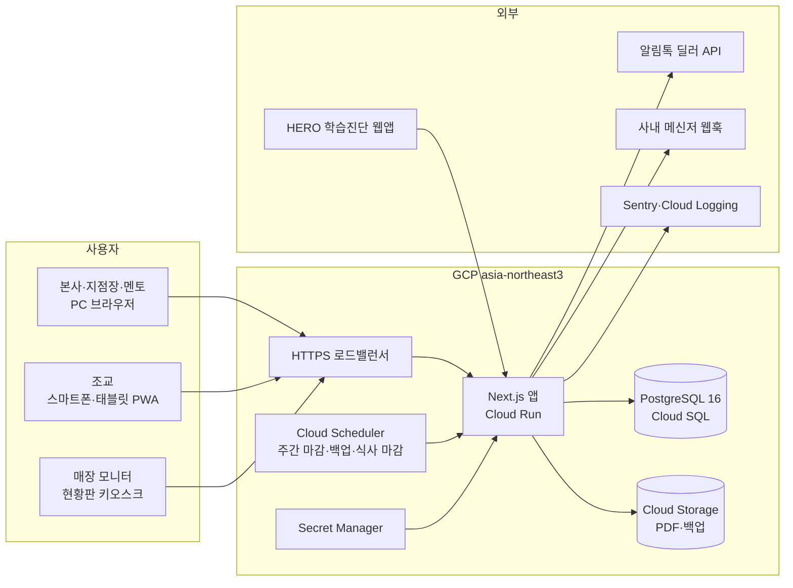
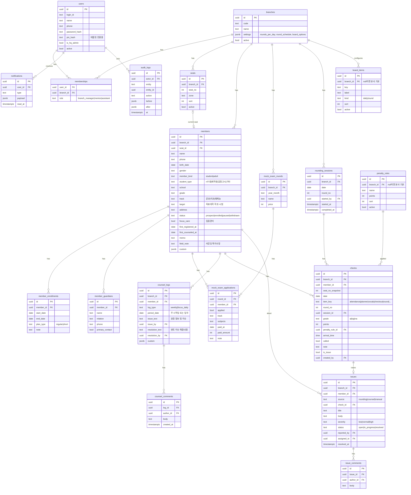

# 프로젝트12 통합관리 플랫폼 · 시스템 설계서

| 항목 | 내용 |
|---|---|
| 버전 | v0.1 초안 (2026-09-05) |
| 전제 | [01_프로젝트_기획서.md](01_프로젝트_기획서.md) 5.2의 A안(풀커스텀 모노리스) 기준 |
| 범위 | 1단계 상세 설계 + 2·3단계 설계 메모 |

---

## 1. 설계 원칙

1. **회원 마스터가 유일한 진실**: 다른 모든 테이블은 `member_id`로 참조하고 이름·좌석을 복사하지 않는다. 화면은 항상 조인해서 보여준다. 단, 라운딩 체크에는 당시 좌석을 스냅샷으로 남겨 이력 정합성을 지킨다.
2. **지점 격리는 두 겹**: 모든 업무 테이블에 `branch_id`를 두고, 앱 계층에서 강제 스코핑 + Postgres RLS를 방어선으로 둔다.
3. **규칙은 데이터**: 벌점 규칙, 현황판 항목, 회차 시간표, 타임 슬롯, 커스텀 필드는 코드가 아니라 설정 테이블이다. 비개발자가 관리 화면에서 바꾼다.
4. **현장 입력은 기본값 + 예외**: 라운딩은 기본 a로 시작하고 조교는 예외만 탭한다. 저장은 항목 단위 즉시 저장, 오프라인 큐.
5. **삭제 대신 상태**: 회원·사용자·좌석은 soft delete(상태·비활성). 기록 테이블은 삭제 불가, 정정은 감사 로그와 함께.

---

## 2. 시스템 아키텍처



### 2.1 구성 요소

| 구성 | 역할 | 비고 |
|---|---|---|
| Next.js 앱 | 화면 렌더링, Server Actions(쓰기), Route Handlers(현황판·웹훅·CSV·외부 API), 배치 엔드포인트 | 단일 컨테이너, 수평 확장 가능 |
| PostgreSQL | 업무 데이터, RLS, 감사 로그 | Cloud SQL 자동 백업 + PITR |
| Cloud Storage | 3단계 PDF, 주간 DB 덤프 | 90일 수명주기 |
| Cloud Scheduler | 매일 00:05 식사 마감 잠금(2단계), 매주 월 00:00 주차 롤오버 체크, 매일 03:00 덤프 | 인증 헤더로 앱 배치 엔드포인트 호출 |
| PWA | 라운딩 화면 오프라인 캐시 + IndexedDB 큐 | 온라인 복귀 시 순서대로 동기화 |

### 2.2 배포 구성

| 환경 | 구성 |
|---|---|
| GCP (기본) | Cloud Run(min 1 인스턴스, 콜드스타트 방지) + Cloud SQL(db-custom-1-3840, 서울) + Cloud Storage + Scheduler + Secret Manager. Cloud Build 또는 GitHub Actions로 이미지 빌드·배포. 관리형 인증서로 HTTPS |
| 로컬 서버 (대안) | docker compose: app, postgres, caddy(HTTPS, 도메인 또는 사설 인증서). 매일 `pg_dump` → NAS 또는 GCS 업로드 |
| 스테이징 | 운영과 동일 구성 축소판. 이관 리허설·UAT에 사용 |

---

## 3. 데이터 모델

### 3.1 ERD (1단계)



### 3.2 테이블 설계 노트 (1단계)

**공통 컬럼**: 모든 테이블에 `id uuid`, `created_at`, `updated_at`. 업무 테이블에 `branch_id`. 기록 테이블에 `created_by`.

| 테이블 | 핵심 규칙 |
|---|---|
| `users` / `memberships` | 한 사용자가 여러 지점에 서로 다른 역할을 가질 수 있다(멘토 겸임 대비). 본사 관리자는 `is_hq_admin`으로 전 지점 접근. 조교의 `pin_hash`는 공용 태블릿 전환용이며 PIN만으로는 PC 로그인 불가 |
| `seats` | 지점 내 `seat_no` 유일. 구역(`zone`)은 라운딩 목록 그룹·색상에 사용. 좌석 수는 지점마다 다르다 |
| `members` | `seat_id`는 `status='enrolled'`인 회원 간 유일(부분 유니크 인덱스). 퇴원 시 `seat_id`를 비우고 `status='withdrawn'`. `field_note`는 라운딩 목록에 항상 표시되는 짧은 특이사항(예: 매주 화 학원 17시 조퇴) |
| `member_enrollments` | 등록기간 이력. 시트의 "7월16~8월17일[33일]"은 `plan_type='short'` 한 건으로 이관. 현재 등록 = `end_date >= today`인 최신 건 |
| `member_guardians` | 학부모 연락처는 별도 테이블로 두어 조교 역할에서 조인 자체를 막는다 |
| `mock_exam_rounds` / `applications` | 회차는 지점별 월 단위. 신청 여부·계열·과목·결제일을 기록하고 계열별 인원은 집계 뷰로 계산 |
| `counsel_logs` | `(member_id, log_type, period_date)` 유일. `weekly`는 `period_date`가 주 시작일(월요일), `focus_daily`는 일자. 원장 열과 멘토 열이 한 행이라 현재 시트 구조와 1:1. 작성자와 시각을 각각 기록 |
| `counsel_comments` | 행 단위 스레드. `@이름` 멘션을 파싱해 `notifications` 생성 |
| `rounding_sessions` | `(branch_id, date, round_no)` 유일. 회차 진행 상태(시작·완료)와 담당 조교를 기록. 회차 수는 `branches.settings.rounds_per_day` |
| `checks` | 현황판의 모든 셀. `(member_id, date, item_key, coalesce(round_no,0))` 유일. `grade`: a 양호, b 사유 있음, p 벌점, na 부재·해당없음. `points`는 `p`일 때 규칙 점수 스냅샷. `attendance` 항목만 `arrival_time`, `called`를 쓴다. 라운딩 화면은 `item_key='round'` 행을 쓰고, 출석·플래너·영단어·점검완료는 일별 항목 |
| `penalty_rules` | 본사 기본(`branch_id null`) + 지점 오버라이드. 시트 규칙 6종을 초기값으로 시드. 규칙 수정은 이후 기록에만 반영(기록의 `points`는 스냅샷) |
| `issues` | 라운딩에서 `is_issue`로 표시하면 자동 생성(`source='rounding'`). 지점장에게 알림. 상태 흐름 open → in_progress → resolved |
| `board_items` | 현황판 행 정의. 초기값: attendance(출석), planner(플래너), round(R1~Rn, kind=round), vocab(영단어), checkout(점검완료). 항목 추가·순서 변경을 관리 화면에서 |
| `notifications` | 코멘트 멘션, 이슈 생성·배정, 상담 미작성 리마인드(옵션). 앱 내 알림함. 3단계에서 메신저 웹훅으로 복제 |
| `audit_logs` | 회원·상담·체크·이슈·설정의 모든 변경. 접근 로그(민감 정보 조회)는 별도 `access_logs`로 회원 상세 열람을 기록 |

### 3.3 커스텀 필드 구조

비개발자 양식 조정 요구를 범위를 좁혀 구현한다.

| 구성 | 내용 |
|---|---|
| `custom_field_defs` | `entity`(member, counsel_log, issue), `key`, `label`, `type`(text, number, date, select, multiselect, boolean), `options jsonb`, `required`, `sort`, `branch_id`(null이면 전 지점), `active` |
| 저장 | 대상 테이블의 `custom jsonb`에 `{key: value}` |
| 화면 | 폼은 정의를 읽어 필드를 렌더링, 목록은 컬럼 추가 가능, CSV 내보내기에 포함, 검색은 select·boolean만 필터 지원 |
| 제한 | 핵심 필드(이름·좌석·상태 등)는 커스텀으로 대체 불가. 필드 삭제는 비활성화만(데이터 보존). 타입 변경 불가(새 필드 생성) |

### 3.4 2·3단계 테이블 (요약)

| 테이블 | 용도 |
|---|---|
| `meal_settings` | 지점별 중·석식 단가, 마감 시각, 요일 규칙(토 중식만, 일 불가), 업체 정보 |
| `meal_orders` | `(member_id, date, meal)` 유일, `ordered`, 단가 스냅샷, 변경자·시각. 마감 후 변경은 지점장만 가능하며 감사 로그 |
| `meal_settlements` | 회원 × 월: 식수, 금액, 결제일, 결제액, 메모 |
| `staff_profiles` | 사용자 확장: 근무형태(주간조교·야간조교·컨설팅·원장), 시급, 직영 여부 |
| `shift_slots` | 지점별 타임 정의(1~7타임, 일1·일2타임, 시작·종료·시간) |
| `work_logs` / `work_log_slots` | 일 × 근무자: 타임 체크, 초과근무 시간·사유, 본사 확인자·시각, 총 시간 |
| `alimtalk_templates` / `alimtalk_messages` | 템플릿 코드·변수, 발송 건별 상태·딜러 메시지 ID·오류 |
| `member_files` | 회원 파일(HERO 결과, AI 리포트, 기타): 종류, 경로, 버전, 업로더 |
| `hero_links` | 회원 ↔ HERO 응답 ID, 요약 JSON, 결과지 URL |
| `event_outbox` | 메신저·알림톡 등 외부 발송 큐(재시도·멱등) |

---

## 4. 권한 및 다지점 설계

### 4.1 역할

| 역할 | 범위 | 비고 |
|---|---|---|
| 본사 관리자 (HQ) | 전 지점 | 상단 지점 전환기로 컨텍스트 선택. 설정·이관·통계 |
| 지점장 (BM) | 소속 지점 | 회원·상담(원장 열)·이슈·현황판·설정 일부 |
| 멘토 (MT) | 소속 지점(복수 가능) | 상담(멘토 열)·코멘트·회원 조회 |
| 조교 (AS) | 소속 지점 | 라운딩·일별 체크·이슈 보고. 개인정보 최소 노출 |
| 현황판 토큰 | 지점 1개 | 로그인 없이 읽기 전용, URL 토큰, 재발급 가능 |

### 4.2 권한 매트릭스 (1단계)

R 조회, W 생성·수정, C 코멘트, - 없음

| 기능 | HQ | BM | MT | AS |
|---|---|---|---|---|
| 지점·사용자·역할 관리 | W | 소속 지점 조교·멘토 계정 W | - | - |
| 벌점 규칙·현황판 항목·회차 시간표 | W(기본) | W(지점 오버라이드) | R | R |
| 커스텀 필드 정의 | W | - | - | - |
| 회원 기본정보 | W | W | R | R(이름·좌석·특이사항·집중관리 여부만) |
| 회원 연락처·학부모·주소·생년월일 | W | W | R | - |
| 등록기간·좌석 배정·상태 변경 | W | W | - | - |
| 모의고사 | W | W | R | - |
| 상담일지 원장 열(issue_text) | R | W | R | - |
| 상담일지 멘토 열(resolution_text) | R | R | W | - |
| 상담 코멘트 | C | C | C | - |
| 라운딩 세션·체크 | R | R + 정정 | R | W(당일), R(최근 7일) |
| 이슈함 | R | W(상태·담당) | C | 생성 + 본인 생성분 R |
| 현황판 설정(마스킹·토큰) | W | W | - | - |
| 감사 로그·접근 로그 | R | 소속 지점 R | - | - |
| CSV 이관·내보내기 | W | 내보내기만 | - | - |

### 4.3 지점 격리 구현

1. **앱 계층**: 요청마다 세션에서 `userId`, `activeBranchId`, `role`을 구해 `ctx`로 만든다. 모든 데이터 접근은 `repo.members.list(ctx, ...)`처럼 `ctx`를 받는 저장소 함수로만 하고, 저장소 함수가 `where branch_id = ctx.activeBranchId`를 강제한다. HQ는 명시적으로 지점을 선택해야 하며 "전체" 조회는 통계 화면에서만 허용.
2. **DB 계층**: 트랜잭션 시작 시 `set local app.user_id`, `app.branch_id`를 설정하고 RLS 정책이 `branch_id = current_setting('app.branch_id')`를 검사한다. HQ는 `app.is_hq = true`로 우회. 앱 버그로 스코핑이 빠져도 DB가 막는다.
3. **컬럼 격리**: 조교 세션에서는 `members`의 연락처·주소·생년월일 컬럼을 select 하지 않는 별도 뷰(`members_assistant_view`)를 쓰고, `member_guardians`는 조인하지 않는다.
4. **테스트**: 역할 × 지점 조합으로 "타 지점 ID를 URL에 직접 넣어도 404"를 검증하는 통합 테스트를 필수로 둔다.

### 4.4 현황판 공개 접근

`/board/{branchId}?t={token}`. 토큰은 지점 설정에서 생성·재발급하며 DB에 해시 저장. 응답에는 이름(또는 마스킹), 좌석, 등급, 점수만 포함하고 연락처 등은 절대 포함하지 않는다. 브라우저 키오스크 모드로 띄우고 60초마다 데이터만 갱신한다.

---

## 5. 화면 설계

### 5.1 사이트맵 (1단계)

```
/login                         로그인 (아이디·비밀번호), 태블릿은 /login/pin
/                              대시보드 (역할별)
/members                       회원 목록 (필터: 상태·집중관리·계열·구역, 검색)
/members/new, /members/[id]    회원 등록·상세 (탭: 기본정보 · 등록이력 · 상담 타임라인 · 라운딩·벌점 · 모의고사 · 파일)
/members/import                CSV 이관 (본사)
/mock-exams, /mock-exams/[id]  회차 목록 · 신청 그리드
/counsel/weekly                주간 상담일지 (회원 × 주차 그리드)
/counsel/focus                 집중관리 개인 일지 (회원 선택 → 일별)
/counsel/logs/[id]             일지 행 상세 + 코멘트 스레드
/rounding                      조교 홈 (오늘 회차 진행 현황)
/rounding/[sessionId]          회차 입력 (모바일 최적화)
/rounding/history              회차·일·회원별 조회
/daily-checks                  출석·플래너·영단어·점검완료 일별 입력 (조교)
/issues, /issues/[id]          이슈함 · 이슈 상세
/board/[branchId]              현황판 (공개 토큰)
/notifications                 알림함
/settings/branch               지점 정보 · 회차 시간표 · 현황판 옵션·토큰
/settings/users                사용자 · 역할 · PIN
/settings/seats                좌석 · 구역
/settings/penalty-rules        벌점 규칙
/settings/board-items          현황판 항목
/settings/custom-fields        커스텀 필드 (본사)
/settings/audit                감사 로그
```

### 5.2 대시보드 (지점장)

오늘 라운딩 진행도(R1~Rn 완료 체크), 미해결 이슈 수와 최근 3건, 이번 주 벌점 상위 5명, 이번 주 상담 미작성 회원 수, 등록 만료 임박 회원(7일 이내). 본사 관리자는 지점별 카드로 같은 지표를 본다.

### 5.3 회원 상세

- 상단 헤더: 이름, 좌석, 상태 배지, 집중관리 배지, 계열·학교·학년, 등록기간(잔여일).
- 탭 **상담 타임라인**: `counsel_logs`, `counsel_comments`, 벌점 `checks`, `issues`, 등록·좌석·상태 변경 감사 로그를 시간 역순으로 한 줄씩. 필터: 종류·기간.
- 탭 **라운딩·벌점**: 주 단위 미니 현황판(이 회원 1열) + 벌점 목록.
- 편집은 사이드 패널. 저장 시 감사 로그, 좌석 변경 시 라운딩 목록·현황판 즉시 반영(다음 조회부터).

### 5.4 집중관리일지

- **주간 보기**: 행 = 회원(좌석 순), 열 = 주차(최근 4주 기본, 월 필터 시 해당 월의 주차 4~5개). 셀은 원장 열·멘토 열 두 칸으로 나뉘고 작성 여부·코멘트 수 배지. 셀 클릭 → 우측 패널에 편집기 + 코멘트 스레드.
- **개인 일지**: 집중관리 회원만 목록에 표시. 선택하면 일자 행 × (원장·멘토) 열. 미래 날짜는 비활성.
- 편집 권한: 원장 열은 BM, 멘토 열은 MT. 상대 열은 읽기 전용이지만 코멘트로 응답한다. 코멘트에 `@이름`이면 알림.
- 잔디 대체 포인트: 회원 관련 소통은 반드시 해당 회원의 일지 행 또는 이슈에 남긴다. 결과가 회원 타임라인에 자동 축적된다.

### 5.5 라운딩 (모바일, 핵심 화면)

흐름:

1. **조교 홈**: 오늘 날짜, 회차 카드 R1~Rn(완료·진행중·예정, 담당자). 다음 회차 "시작" 버튼이 크게.
2. **회차 입력**: 좌석 순 리스트, 구역별 구분선과 색상. 각 행은 `좌석번호 | 이름 | 특이사항(field_note) | 상태 칩`. 상태 칩 기본 **a**. 탭하면 바텀시트: a / b(사유 선택: 학원·조퇴·외출 등) / 벌점(규칙 목록 → 점수 자동, 메모) / 부재. 벌점·부재 시 "이슈로 보고" 토글.
3. **자동 저장**: 항목 변경 즉시 서버 저장. 오프라인이면 IndexedDB 큐에 쌓고 상단에 "미전송 n건" 표시, 복귀 시 순서대로 전송.
4. **회차 완료**: 요약(벌점 n건 m점, 이슈 n건, 부재 n명) → 확인 → 세션 `completed_at` 기록, 이슈는 지점장 알림.
5. **정정**: 완료 후 수정은 당일 한정, 사유 입력, 감사 로그. 지점장은 기한 없이 정정 가능.

UI 요구: 한 손 조작, 행 높이 48px 이상, 스크롤 위치 유지, 검색(이름·좌석) 상단 고정, 밝은 매장 조명에서 읽히는 대비.

**일별 체크(/daily-checks)**: 출석(등원시간·CALL 여부 포함), 플래너, 영단어, 점검완료를 같은 리스트 UI로 입력. 출석은 등원 시 체크, 나머지는 퇴실 전 점검 시 체크.

### 5.6 현황판

- 레이아웃: 상단 규칙 헤더(활성 벌점 규칙을 "이름[점수]"로 나열) + 주간 벌점 합계 행 + 좌석번호 행 + 이름 행(세로 쓰기 또는 마스킹). 본문은 일자 블록(월~일)마다 `board_items` 순서대로 행. 좌석은 `seats` 순서, 등록 회원만.
- 색상: a 초록(#57BB8A 계열), b 연두, p 빨강 배경 + 흰 점수, na·미입력 흰색. 색맹 대비를 위해 p는 숫자, b는 작은 점 표시.
- 갱신: 60초 폴링(데이터만). 주 전환은 서버 시각 기준 월요일 00:00.
- 반응형: 1920×1080 기준 50석까지 스크롤 없이, 그 이상은 가로 스크롤 대신 2단 분할 옵션.

### 5.7 이슈함

목록(상태·심각도·회원·보고자·일시), 상세(원본 라운딩 체크 링크, 코멘트, 상태 변경, 담당자). 지점장 대시보드와 알림함에 노출. 3단계에서 메신저 채널로 자동 게시.

### 5.8 설정

지점(회차 수·시간표·현황판 옵션·토큰), 사용자(역할·지점·PIN 초기화), 좌석(구역·순서·비활성), 벌점 규칙(이름·점수·순서), 현황판 항목(라벨·순서·활성), 커스텀 필드(본사), 감사 로그 조회.

---

## 6. 핵심 업무 규칙

| 영역 | 규칙 |
|---|---|
| 회원 상태 | prospect(상담) → enrolled(등록) → withdrawn(퇴원). paused(휴원)는 옵션. enrolled만 좌석 보유·라운딩·현황판 대상. 퇴원 시 좌석 해제, 미래 식사주문 취소(2단계) |
| 좌석 | 지점 내 유일, 회원당 하나. 좌석 이동은 즉시 반영되며 과거 체크는 `seat_no_snapshot` 유지 |
| 등록기간 | 최신 enrollment의 `end_date`가 만료 기준. 만료 7일 전 대시보드 표시. 자동 퇴원은 하지 않는다(좌석관리 프로그램과 이중 관리) |
| 라운딩 회차 | 지점 설정의 회차 수(기본 12)와 시간표. 같은 날 같은 회차는 세션 하나. 미완료 세션은 다음 회차 시작 시 경고 |
| 등급·벌점 | a=0점, b=0점(사유 기록), p=규칙 점수 스냅샷. 주간 합계 = 월~일 `points` 합. 연속 졸음 같은 복합 규칙은 조교가 규칙을 직접 고르되, 같은 날 졸음 2회 이상이면 "연속 졸음" 추천 표시 |
| 상담 주차 | 월요일 시작. 월 필터는 주 시작일이 속한 월 |
| 코멘트·알림 | 코멘트 작성 시 행의 상대 작성자 + 멘션 대상에게 알림. 이슈 생성 시 지점장 전원 알림 |
| 정정 | 체크·상담은 삭제 불가, 수정은 감사 로그. 조교 정정은 당일 한정 |
| 식사(2단계) | 마감: 전일 설정 시각(기본 23:59). 토요일 중식만, 일요일 불가, 공휴일은 지점 설정. 정산 = Σ(주문 × 단가 스냅샷) |
| 근무(2단계) | 총 시간 = Σ(체크한 타임 시간) + 초과근무. 본사 확인 후 잠금. 월 집계는 확인된 건만 |

---

## 7. API 설계 개요

쓰기는 Server Actions, 외부·공개·배치는 Route Handlers. 모든 핸들러는 `ctx` 생성 → 권한 검사 → 저장소 호출 → 감사 로그 순서를 지킨다.

| 종류 | 경로·액션 | 비고 |
|---|---|---|
| Server Action | `members.create/update/changeStatus/assignSeat`, `counsel.upsertLog/addComment`, `rounding.startSession/upsertCheck/completeSession`, `issues.create/update/comment`, `settings.*` | zod 스키마 검증, 역할 검사 |
| Route Handler | `GET /api/board/{branchId}?t=` | 공개 토큰, 캐시 30초 |
| Route Handler | `POST /api/import/members` (multipart CSV) | 본사, 검증 리포트 반환 후 `commit=true`로 확정 |
| Route Handler | `POST /api/jobs/{name}` | Scheduler 전용, 헤더 시크릿 |
| Route Handler | `POST /api/webhooks/alimtalk` (2단계), `POST /api/integrations/hero` (3단계) | 서명 검증 |
| Route Handler | `POST /api/rounding/sync` | PWA 오프라인 큐 일괄 전송, 멱등 키로 중복 방지 |

---

## 8. 데이터 이관 설계

### 8.1 대상과 매핑

| 원본 시트 | 대상 | 매핑 포인트 |
|---|---|---|
| 고객정보 › 고객정보 탭 | `members`, `member_enrollments`, `member_guardians`, `seats` | 좌석번호 → `seats`(없으면 생성). 이름 "/S" → `plan_type='short'`, 기간 문자열 파싱. 구분·TYPE·계열 → enum 매핑. 빈 셀은 null. 상태는 좌석 있음=enrolled, 없음=prospect로 초기화 후 발주사 검수 |
| 고객정보 › 모의고사 탭 | `mock_exam_rounds`, `mock_exam_applications` | 월 블록 하나 = 회차 하나. 신청여부 O만 생성 |
| 집중관리일지 (2026년 월 파일) | `counsel_logs` | 주간 탭: N주차 → 해당 월 N번째 월요일. 개인 탭: 날짜 행 → `focus_daily`. 빈 행은 생성 안 함 |
| 현황판 (최근 4주, 선택) | `checks` | 셀 색상·값 → grade·points. Apps Script 또는 Sheets API로 배경색 export 필요 |
| 식사주문 (2단계, 당월·전월) | `meal_orders`, `meal_settlements` | 체크박스 → ordered |
| 근무일지 (2단계, 당월) | `work_logs` | 타임 체크 → slots |

### 8.2 절차

1. 발주사가 시트를 정리(퇴원자 표시, 좌석 중복 해소)하고 CSV로 내보낸다.
2. 이관 도구에 업로드 → 자동 컬럼 매핑(헤더 기준) → 검증 리포트(필수 누락, 좌석 중복, 연락처 형식, enum 불일치, 이름 중복).
3. 오류 0건이 될 때까지 시트 수정·재업로드. 경고는 확인 후 진행.
4. 스테이징에서 리허설 2회(W10), 운영 이관 1회(W12 컷오버 직전).
5. 이관 결과 보고서(건수 대조표) 제출, 발주사 검수 서명.

---

## 9. 보안·개인정보

| 항목 | 설계 |
|---|---|
| 전송 | HTTPS 강제, HSTS. 내부 통신은 VPC |
| 인증 | 아이디·비밀번호(bcrypt/argon2), 비밀번호 정책(10자 이상), 5회 실패 잠금, 세션 쿠키(HttpOnly, SameSite=Lax), 본사 계정 TOTP 옵션. 태블릿 PIN은 매장 IP 또는 등록 기기에서만 |
| 접근 통제 | 4장 권한 매트릭스 + RLS. 조교 뷰에서 민감 컬럼 제거 |
| 민감 정보 | 학부모 연락처·상담 기록 열람은 `access_logs`에 기록. 목록에서는 연락처 뒷자리 마스킹, 상세에서만 전체 표시 |
| 저장 | Cloud SQL 디스크 암호화(기본). 백업 덤프는 GCS CMEK 또는 기본 암호화 + 버킷 비공개 |
| 보관·파기 | 퇴원 후 보관기간(예: 1년, 발주사 정책 확정 필요) 경과 시 개인정보 익명화 배치. 상담 기록은 회원 식별 제거 후 통계용 보존 여부 결정 |
| 로그 | 감사 로그 무기한, 접근 로그 1년, 앱 로그 30일 |
| 현황판 | 토큰 URL, 마스킹 옵션, 연락처 등 비포함 |
| 문서 | 개인정보 처리방침·내부 관리계획 초안 제공(법률 검토는 발주사) |

---

## 10. 비기능 요구사항

| 항목 | 목표 |
|---|---|
| 규모 (가정) | 지점 10개, 지점당 80석, 동시 사용자 50, 체크 레코드 연 200만 건 |
| 성능 | 목록·현황판 응답 1초 이내(p95), 라운딩 체크 저장 300ms 이내 |
| 가용성 | 영업시간(07~24시) 기준 99.5%. Cloud Run min 1, Cloud SQL 자동 재시작 |
| 백업 | Cloud SQL 일 자동 백업 7일 보관 + PITR 7일, 주간 덤프 GCS 90일. 분기 1회 복구 훈련 |
| 브라우저 | Chrome·Safari·Samsung Internet 최신 2개 버전. 현황판은 Chrome 키오스크 |
| 접근성 | 색상 외 표식(점수·점), 폰트 확대 대응 |
| 관측 | Sentry 오류, Cloud Logging 구조화 로그, 업타임 체크 5분 |

---

## 11. 테스트 전략

| 수준 | 대상 | 도구 |
|---|---|---|
| 단위 | 벌점 합계, 주차 계산, 등록 만료, 식사 마감·정산, 근무시간 계산, CSV 파서 | Vitest |
| 통합 | 권한 매트릭스 × 지점 격리(타 지점 ID 직접 접근), RLS 정책, 이관 검증 리포트 | Vitest + 테스트 DB |
| E2E | 라운딩 회차 시작→입력→오프라인→복귀→완료→이슈 알림, 상담 코멘트 멘션 알림, 현황판 갱신 | Playwright(모바일 뷰포트 포함) |
| UAT | 기획서 8.2 검수 항목을 체크리스트로, 파일럿 지점 병행 운영 1주 | 발주사 + 수급사 |
| 보안 | 의존성 취약점 스캔, OWASP 상위 10 점검, 권한 우회 시나리오 | CI + 수동 |

---

## 12. 운영·모니터링·백업

- **배포**: main 브랜치 머지 → CI(테스트·빌드) → 스테이징 자동 배포 → 수동 승인 → 운영. 롤백은 Cloud Run 이전 리비전 트래픽 전환.
- **마이그레이션**: Drizzle 마이그레이션을 배포 전 단계에서 실행. 파괴적 변경은 2단계(추가 → 전환 → 삭제).
- **배치**: Scheduler → `/api/jobs/*`. 실패 시 Sentry 알림, 재실행 멱등.
- **모니터링 대시보드**: 요청 오류율, p95 지연, DB 연결 수, 라운딩 동기화 실패 건수, 알림톡 실패율(2단계).
- **월 유지보수 체크리스트**: 백업 복구 샘플 확인, 의존성 업데이트, 감사 로그 용량, 토큰 재발급 주기, 미사용 계정 비활성화.

---

## 13. 2단계 설계 메모

**식사주문·정산**
- 화면: 월 그리드(행 = 회원, 열 = 날짜 × 중/석식 체크). 마감 지난 셀은 잠금 표시. 하단 일자별 합계 행과 "오늘 발주서" 버튼(업체 전달용 인쇄·CSV).
- 규칙: 마감 시각 이후 변경은 지점장만, 사유 필수. 요일 규칙은 지점 설정. 단가는 주문 시점 스냅샷.
- 정산: 월말 배치가 `meal_settlements` 생성, 지점장이 결제 확인 입력. 회원별 청구 내역을 알림톡 템플릿으로 발송 가능.

**근무일지·급여**
- 화면: 조교 홈에 "출근 체크" 카드(현재 타임 자동 제안), 지점장 일별 근태표, 본사 월 집계표.
- 규칙: 타임 슬롯은 지점별 정의(평일 1~7, 주말 일1·일2). 초과근무는 사유 필수, 본사 확인 후 잠금. 급여 기초자료는 CSV(근무자·타임 수·시간·초과·합계).
- 잔디 대체: 출퇴근 보고 메시지 대신 체크. 체크 시 지점장 알림(옵션).

**알림톡**
- 딜러 API 어댑터 인터페이스(`send(template, to, vars)`)로 딜러 교체 가능하게. 발송은 `event_outbox`를 통해 비동기, 실패 재시도 3회.
- 대상 선택: 회원 본인 / 학부모(주 연락처) / 지점 전체 / 저장된 그룹(예: 집중관리). 발송 전 미리보기와 건수·예상 비용 표시.
- 수신 거부·미가입(카카오 미사용) 처리: 딜러 실패 코드 저장, 대체 발송(SMS)은 옵션.

---

## 14. 3단계 설계 메모

**HERO 학습진단 연동**
- 우선안: HERO 앱이 설문 완료 시 `POST /api/integrations/hero`로 회원 식별자(연락처 또는 사전 발급 코드)·결과 요약·결과지 URL을 전송. 서명 검증 후 `hero_links` 저장, 회원 상세 "파일" 탭에 표시.
- 대안: 결과지 PDF 수동 업로드(`member_files`). API 협의가 늦어지면 대안으로 먼저 오픈.

**AI 컨설팅 리포트**
- `member_files`에 kind=ai_report, 버전 관리. GCS 서명 URL로 열람(만료 10분). 열람은 접근 로그.

**사내 메신저**
- 후보: Rocket.Chat(MIT), Mattermost(Team Edition), Zulip(Apache 2.0). 선정 기준: 모바일 푸시 비용·한도, 지점별 채널·권한, 웹훅 API, 한국어 UI.
- 구성: GCE VM(docker compose) 또는 Cloud Run 불가 시 GKE Autopilot. 지점별 채널 + 본사 공지 채널. SSO는 범위 외(계정 별도).
- 플랫폼 연동: `event_outbox`의 이슈 생성·고벌점·상담 미작성 이벤트를 지점 채널 웹훅으로 게시. 메시지에는 회원 이름과 좌석만, 링크로 상세 이동(로그인 필요).
- 검증 항목: iOS·Android 푸시 수신, 백그라운드 수신, 지점 채널 격리, 웹훅 게시 지연 1분 이내.
